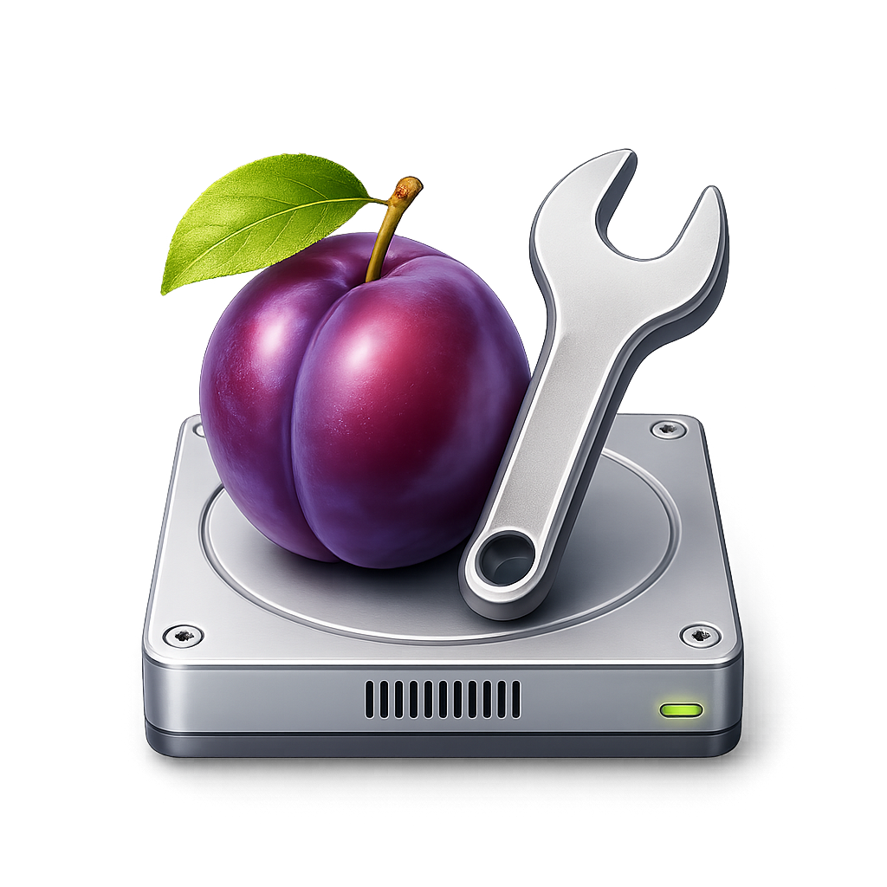

# Plumbyr

**A free, open-source CCleaner alternative for Windows.**

Reclaim disk space, find storage hogs, and troubleshoot your PC from one app. Preview cleanup results and choose what changes.

**[Download the latest release](https://github.com/skonester/Plumbyr/releases/latest)** · [Report a bug](https://github.com/skonester/Plumbyr/issues) · [Technical guide](architecture.md)

## Why use Plumbyr?

- **Clean with a clear picture.** Analyze temporary files and application, browser, and gaming caches. Review file counts and sizes before cleaning selected items.
- **Find where your storage went.** Explore drives and folders in Space map, drill into the largest folders, and reveal any of the 40 biggest files in Explorer.
- **Recover deleted files.** Choose a drive or disk image in Sources, review found files and picture previews, then recover selected files to another drive.
- **Investigate Windows and sleep problems.** Collect hardware and power reports, inspect wake sources, and run separate Windows health checks or repairs. Sleep controls include monitoring and a cancelable QuickOff countdown.
- **Keep maintenance tools together.** Inspect installed drivers, check Windows Update for driver updates, back up drivers, and use Command Center for diagnostics and commands.
- **Choose your Windows tweaks.** Apply selected privacy, background-app, advertising, and gaming settings, with an option to create a restore point first.
- **Take it with you.** Use the portable executable or the installer. The published app includes its runtimes; you don't need to install .NET or Node separately.

## Get started

**Windows 10 or 11, x64. Administrator access is required.**

1. Open [Releases](https://github.com/skonester/Plumbyr/releases/latest) and download the **setup** executable to install, or the **portable** executable to run directly.
2. Launch Plumbyr and approve the Windows administrator prompt.
3. Choose a cleanup category, select **Analyze**, review the results, then clean the items you want to remove.

For a look at disk usage without deleting anything, start with **Space map**. Use **Browsers** to inspect Chromium browser caches, or **Sleep** to investigate sleep and wake behavior.

Cleanup permanently deletes selected files. Privacy-data cleanup can sign you out of apps and websites. QuickOff may hibernate depending on your PC.

## Help and development

Found a problem or have an idea? [Open an issue](https://github.com/skonester/Plumbyr/issues).

For build instructions, feature details, tests, release packaging, and third-party credits, see the [architecture and contributor guide](architecture.md).

P.L.U.M.B.Y.R stands for **Plumbing Linked Universal Maintenance & Binary Yield Reclaimer**. Licensed under [GPL-3.0-or-later](LICENSE).
